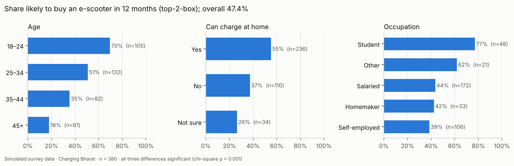
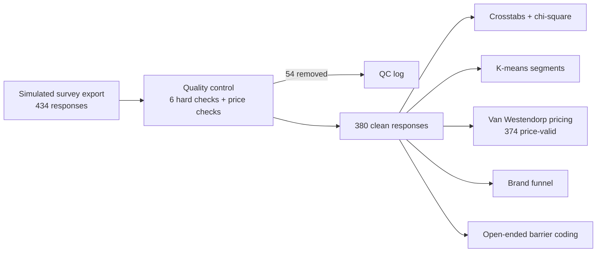
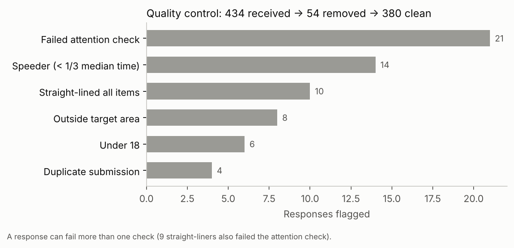
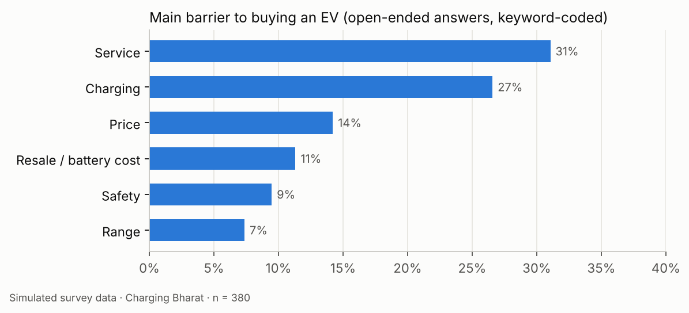
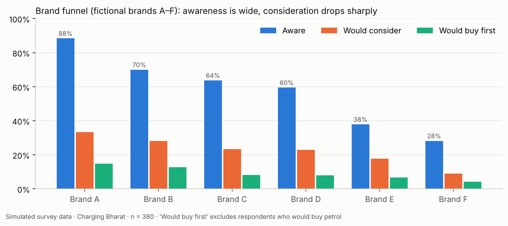
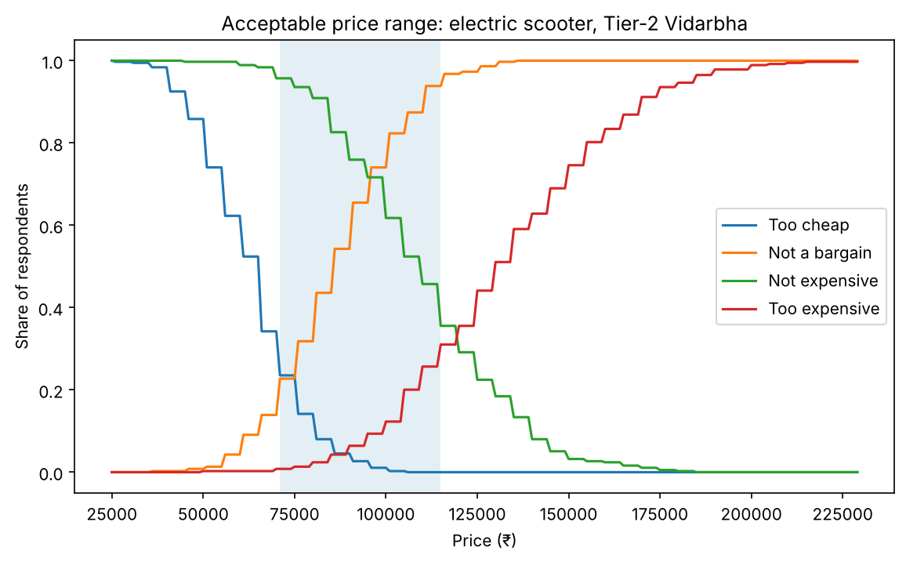
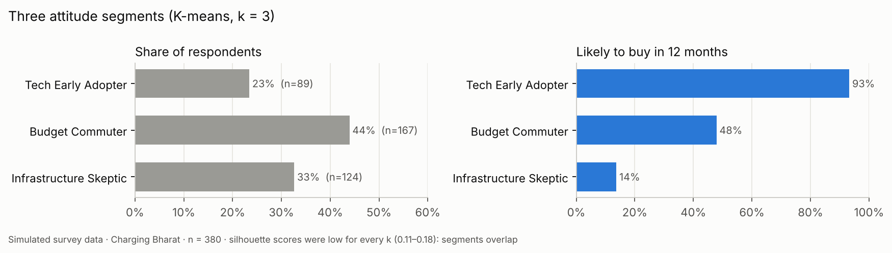

# Charging Bharat: EV Scooter Purchase Intent Survey (Tier-2 Vidarbha)

Market research on whether people in Nagpur and smaller Vidarbha towns (Gondia, Bhandara, Chandrapur, Wardha) would buy an electric scooter, what stops them, what price they find acceptable, and which brands they consider. Built end to end in **Python**: survey quality control, crosstabs with significance tests, segmentation, Van Westendorp pricing and a brand funnel.

> **All respondent data is simulated**, created by [`generate_survey.py`](generate_survey.py) (seeded, so every run gives the same numbers). Brands A–F are fictional. Bad responses were planted on purpose so the quality-control step can be tested, and the respondent types and drivers of intent were built into the generator, so the analysis shows the **method**, not real market facts.



## How it works



## Key findings (simulated data, clean base n = 380)

| Area | Finding |
| --- | --- |
| Intent | **47.4%** say they will probably or definitely buy an e-scooter in the next 12 months (top-2-box). |
| Age | Intent falls with age: 18–24 **70%**, 25–34 51%, 35–44 35%, 45+ **18%** (chi-square p < 0.001). |
| Home charging | Those who can charge at home: **55%** intent vs 37% who can't (p < 0.001). |
| Occupation | Students are most likely (77%), self-employed least (39%) (p < 0.001). |
| Town | Smaller towns show higher intent than Nagpur (**51.9% vs 41.7%**), but the difference is **not significant** (p = 0.060), so it is reported as a direction, not a finding. A likely reason: 72.6% in smaller towns can charge at home vs 48.8% in Nagpur. |
| Infrastructure | Only 11.3% agree public charging points are available and 10.8% that a service centre is nearby; in smaller towns it is under 3% for both. |
| Barriers | Main barrier (open-ended, keyword-coded): **service 31%**, charging 27%, price 14%, resale/battery cost 11%, safety 9%, range 7%. |
| Price | Acceptable range **₹71,000 – ₹1,15,000**; optimal price point ₹86,000; indifference price ₹96,000 (n = 374 with valid price answers). 54.7% would prefer EMI. |
| Brands | Awareness is wide but consideration drops sharply: Brand A is known by 88% but considered by 33% and preferred by 15%. |
| Segments | **Budget Commuter** 44% (48% intent), **Infrastructure Skeptic** 33% (14% intent), **Tech Early Adopter** 23% (93% intent). |

What it means for a brand entering these towns: the blocker is after-sales and charging, not awareness. A service point and charging help in each town, plus an EMI offer around ₹86,000–96,000, would address the top barriers and the price window.

| Quality control | Main barriers |
| --- | --- |
|  |  |

| Brand funnel | Price sensitivity (Van Westendorp) |
| --- | --- |
|  |  |



## Questionnaire

29 items in 8 blocks (screener, brand funnel, 8 attitude statements + attention check, usage, Van Westendorp pricing, intent, open-ended barriers, profile). Full text: [`03_survey/questionnaire.md`](03_survey/questionnaire.md); codes and answer options: [`03_survey/codebook.csv`](03_survey/codebook.csv).

## What separates the segments

Average agreement (1 = strongly disagree, 5 = strongly agree) with each attitude statement:

| Statement | Infrastructure Skeptic | Tech Early Adopter | Budget Commuter |
| --- | --- | --- | --- |
| B1 Range is enough for my daily travel | 2.33 | **3.73** | 2.95 |
| B2 Charging points are easily available | 1.68 | 2.53 | 2.52 |
| B3 Service centres are available near me | 1.60 | 2.82 | 2.40 |
| B4 I worry about battery safety (fire risk) | **4.17** | 2.36 | 3.28 |
| B5 Lower running cost is a major reason | 3.35 | 3.76 | **4.53** |
| B6 I worry about resale value | **4.19** | 2.63 | 3.92 |
| B7 New technology excites me | 2.55 | **4.31** | 2.89 |
| B8 A trusted brand matters more than a lower price | **4.02** | 2.92 | 3.24 |
| Share of respondents | 33% | 23% | 44% |
| Likely to buy in 12 months | 14% | 93% | 48% |

- **Tech Early Adopters** like new technology and believe the range is enough: they are ready now.
- **Budget Commuters** are drawn by low running cost but worry about resale: an EMI offer and a buy-back or resale guarantee speak to them.
- **Infrastructure Skeptics** worry about battery safety and resale, trust established brands, and see no charging or service nearby: they need proof (safety certification, local service) before they consider an EV.

**Drivers of intent** (Spearman ρ with E1, all p < 0.001): battery-safety worry is the strongest negative link (ρ = −0.54), then excitement about new technology (+0.48) and believing the range is enough (+0.46); resale worry (−0.36) and preferring a trusted brand (−0.27) also pull intent down.

## Quality control

[`qc.py`](qc.py) flags every response before any analysis:

| Check | Rule | Flagged |
| --- | --- | --- |
| Attention check | B9 must be "Agree" (the question asks for it) | 21 |
| Speeder | completed in under one third of the median time | 14 |
| Straight-liner | the same answer on all 8 attitude statements | 10 |
| Outside target area | town outside Vidarbha | 8 |
| Under 18 | outside the target age | 6 |
| Duplicate | identical answers to every question | 4 |
| Price logic (kept, excluded from pricing only) | the four price answers must rise: too cheap < cheap < expensive < too expensive | 6 |

**434 received → 54 removed → 380 clean**, and 374 of those are valid for pricing. A response can fail several checks (9 straight-liners also failed the attention check). The 54 removed are exactly the responses the generator planted, and no genuine response was removed. Every flag is listed in [`05_qc/qc_log.xlsx`](05_qc/qc_log.xlsx).

## Methods

| Method | What it answers | Where |
| --- | --- | --- |
| Crosstabs + chi-square test | Does intent differ by age, town, home charging, current vehicle, occupation? Groups with low expected counts are flagged. | `analysis.py` A, `crosstabs.xlsx` |
| K-means on the 8 attitude statements (standardised) | Which attitude groups exist? k = 2–6 compared with silhouette scores. | `analysis.py` B |
| Van Westendorp price sensitivity | Which price range is acceptable? Uses the four price questions D1–D4. | `analysis.py` C |
| Brand funnel | Aware → would consider → would buy first, per brand | `analysis.py` D |
| Spearman correlation | Which attitudes move with purchase intent? | `analysis.py` E |
| Keyword coding | Groups open-ended barrier answers (English and Hinglish) into 6 themes | `summary.py` |

## Limitations

- **Simulated data.** The three respondent types and the drivers of intent were built into the generator, so segmentation and driver analysis recover patterns that were planted. On real data the same code would run unchanged.
- **Segments overlap.** Silhouette scores were low for every k (0.11–0.18) and slightly higher at k = 2. Three segments were kept because they are distinct and usable for marketing; with real data this choice should be tested again.
- **Open-ended coding** uses keywords. It works on these answers, but real answers are messier and would need manual review of a sample.
- **Sample size.** Some subgroups are small (e.g. "Other" occupation, n = 21), so their percentages are less reliable.
- The survey part of the original plan is built here; the secondary-data (VAHAN registrations), review-mining and market-sizing modules are not part of this repository.

## How to run

```bash
pip install -r requirements.txt
python generate_survey.py   # 04_data/raw_responses.xlsx (434 responses)
python qc.py                # 05_qc/qc_log.xlsx and survey_clean.csv (380 clean)
python analysis.py          # crosstabs, segments, Van Westendorp, funnel, drivers
python summary.py           # 06_analysis/outputs/results.txt (headline numbers)
python charts.py            # 06_analysis/outputs/charts/ (report charts)
```

## Repository structure

| Path | Contents |
| --- | --- |
| `generate_survey.py` | Creates the simulated survey export, including the planted bad responses |
| `qc.py` | Quality-control flags, QC log, clean file |
| `analysis.py` | Crosstabs, segmentation, pricing, funnel, drivers |
| `summary.py` | Headline numbers in plain text |
| `charts.py` | Report charts |
| `04_data/` | Raw simulated responses |
| `05_qc/` | QC log and clean responses |
| `06_analysis/outputs/` | Results, tables and charts |

---
Author: **Salil Gokhale** · [LinkedIn](https://www.linkedin.com/in/salil-gokhale-analytics)
